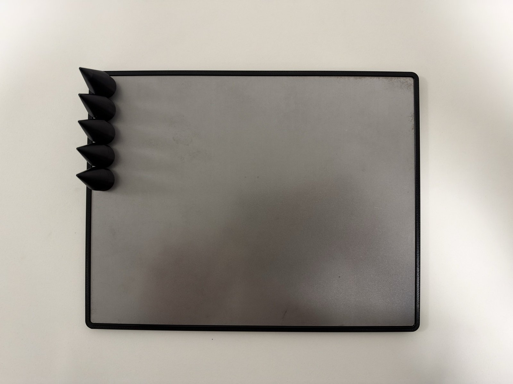
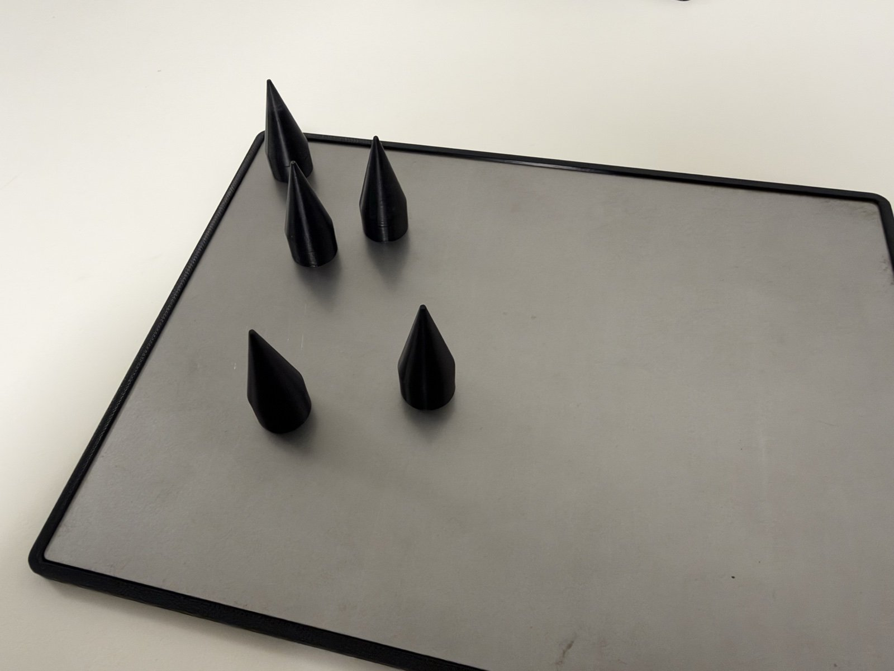
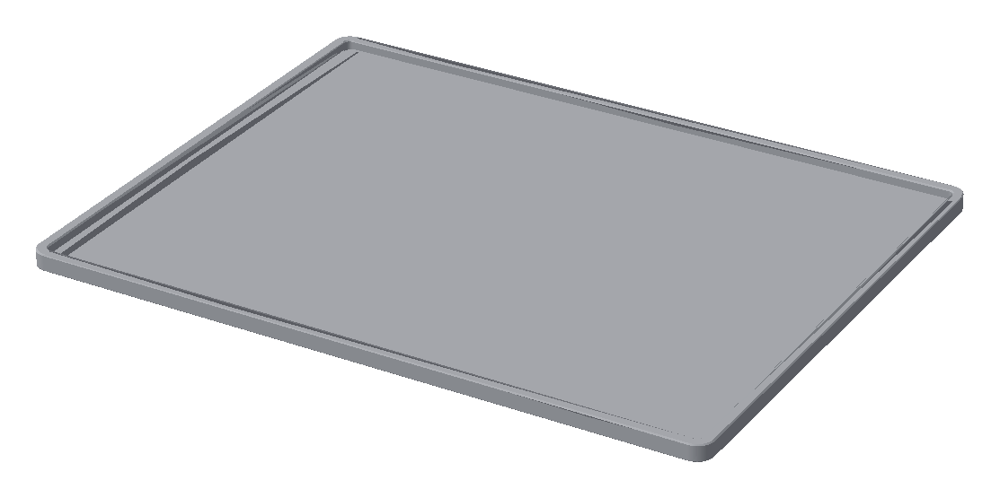

# Rework Base

**Version 0.1 (in development)** | **Last Updated: 2026-11-09** | **ESD Safe** | **Designed for Automotive Class 3**

)

> **Work in progress.** Design files, documentation and license will be added as the project develops.

---

## Table of Contents

- [Description](#description)
- [Project Family](#project-family)
- [Version Information](#version-information)
- [Author and Origin](#author-and-origin)
- [ESD 3D Printing](#esd-3d-printing)
- [Repository Contents](#repository-contents)
- [License](#license)
- [Contributing](#contributing)
- [Support & Contact](#support--contact)

---

## Description

Rework Base is an ESD-safe, 3D-printed base for electronics rework work — the next part of an open hardware toolset for handling, reworking and inspecting PCBs and SMD components at a hot-air rework station and under a microscope.

The product is intended for the **automotive industry** and is designed throughout with **Class 3 (high-reliability electronic products, IPC-A-610 / IPC-7711/7721)** requirements in mind. Every design decision — geometry, material choice, ESD properties and handling of the PCB during rework — follows from the needs of Class 3 automotive production, where defects introduced during rework are not acceptable.

### Design Concept

The strength of Rework Base lies in the **simplicity of its design**. It consists of only a few parts, yet it offers both **rigidity and full variability**:

- **Metal base plate recessed in an ESD frame** — the metal plate is embedded in a 3D-printed ESD-dissipative frame. The frame encloses the plate edges and gives the whole base a safe, ESD-compliant outline on the workbench.
- **Supports with neodymium magnets** — the cone-shaped supports hold to the metal plate by neodymium magnets. They stay firmly in place during rework, yet can be freely repositioned on the plate in seconds.
- **Variability without tools** — the number and position of the supports adapt to any PCB size, shape or connector layout, with no screws, clamps or tools and no PCB-specific fixture.
- **Better and safer handling** — the PCB rests on a few ESD-safe support points instead of lying flat on the workbench, so components on the underside and the connectors are protected and the board stays stable while it is being reworked.

 

*Left: top view of the base with the cone supports. Right: cone supports positioned on the plate.*

*3D render of the Rework Base plate (from `3mf/ReworkBasePlate-FIT-SIZE.3mf`).*

### Dimensions

| Parameter | Value |
|-----------|-------|
| Outer dimensions (L × W) | 211.7 × 164.7 mm |
| Height | 5.0 mm |
| Shape | Flat base plate with a raised perimeter rim and rounded corners |

*Detailed description and photos will follow.*

---

## Project Family

Rework Base is part of a series of ESD-safe, 3D-printed tools for PCB and SMD work:

| Project | Purpose | OSHWA UID |
|---------|---------|-----------|
| [Ergonomic SMD Manipulation Pen](https://github.com/Hessevalentino/Ergonomic-SMD-Manipulation-Pen) | Hand tool for manipulating SMD components at a hot-air rework station or under a microscope | [CZ000015](https://certification.oshwa.org/cz000015.html) |
| [Pyramid PCB Inspection Fixture](https://github.com/Hessevalentino/Pyramid-PCB-Inspection-Fixture) | Fixture for positioning and stabilizing PCBs during microscopic inspection | [CZ000014](https://certification.oshwa.org/cz000014.html) |
| **Rework Base** (this project) | ESD-safe base for rework work | — |

---

## Version Information

| Parameter | Value |
|-----------|-------|
| **Current Version** | 0.1 |
| **Design Status** | In development |
| **Industry Sector** | Automotive |
| **Product Class** | Class 3 (high-reliability electronic products) |
| **Compliance (target)** | IPC-A-610 Class 3, IPC-7711/7721, IEC 61340-5-1 |
| **License** | To be defined |

---

## Author and Origin

| Role | Name |
|------|------|
| **Inventor and lead designer** | Valentino Hesse |
| **Consultant and co-designer** | OK2MTS |

The Rework Base was invented and designed by **Valentino Hesse**, with **OK2MTS** contributing as consultant and co-designer. The project originates from professional work with ESD-sensitive electronics and is developed as an open hardware project for the technical community.

---

## ESD 3D Printing

All functional parts of this project are intended to be printed from an **ESD-dissipative** filament, so the printed part can be safely used around ESD-sensitive components inside an EPA (ESD Protected Area).

### Manufacturing Specifications

- **Material:** ESD PETG (Electrostatic Discharge dissipative polyethylene terephthalate glycol)
- **Manufacturing Technology:** Additive manufacturing (FDM 3D printing)
- **Application:** Hot-air rework and microscopic inspection of PCBs and SMD components

### Required ESD Material Parameters

| Parameter | Value | Standard |
|-----------|-------|----------|
| Surface Resistivity | 10⁶ – 10⁹ Ω | IEC 61340-5-1 |
| Volume Resistivity | 10⁴ – 10¹¹ Ω·cm | IEC 61340-5-1 |
| Charge Decay Time | < 2 s | IEC 61340-5-1 |
| Printing Temperature | 230 – 250 °C | — |
| Bed Temperature | 70 – 85 °C | — |
| Density | 1.27 – 1.29 g/cm³ | — |

**Note:** The material must comply with IEC 61340-5-1 for protection of electronic components against electrostatic discharge. Use an ESD-**dissipative** filament (e.g. 3DXTech ESD-PETG or an equivalent with ESD certification). Fully conductive filaments are not a substitute — their resistance is too low for the dissipative range above.

### Printing Recommendations

- Dry the filament before printing; moisture affects both print quality and ESD properties.
- Use a hardened or wear-resistant nozzle — carbon-loaded ESD filaments are abrasive.
- Do not apply coatings, paints or adhesives to contact surfaces; they can insulate the part.
- **Verify ESD properties of every printed part** (surface resistance measurement) before using it in an EPA.

---

## Repository Contents

### Manufacturing Files

- **`3mf/ReworkBasePlate-FIT-SIZE.3mf`** - Bambu Studio project for 3D printing the base plate

  Print profile stored in the project: Bambu Lab A1, 0.4 mm nozzle, 0.28 mm layer height, 2 walls, 15 % infill. The project is set to a generic PETG filament profile — **switch it to your ESD PETG filament profile before printing** (see [ESD 3D Printing](#esd-3d-printing)).

### Images

- **`images/rework-base-top-view.jpg`** - Photo of the base, top view with cone supports
- **`images/rework-base-supports.jpg`** - Photo of the cone supports on the plate
- **`images/rework-base-render.png`** - 3D render of the base plate

*CAD source files, STL and further documentation (BOM, TESTING, CHANGELOG) will be added during development.*

---

## License

The license has not been selected yet. Until a license file is added, all rights are reserved by the author.

---

## Contributing

The project is in an early stage. Ideas and feedback are welcome via GitHub issues.

---

## Support & Contact

**Author:** Valentino Hesse
**Repository:** https://github.com/Hessevalentino/Rework-Base

- 🐛 **Bug reports:** Open an issue with "Bug:" prefix
- 💡 **Feature requests:** Open an issue with "Feature:" prefix
- 💬 **Questions:** Open an issue with "Question:" prefix

---

**Copyright © 2026 Valentino Hesse**

**Made with ❤️ for the open hardware community**
